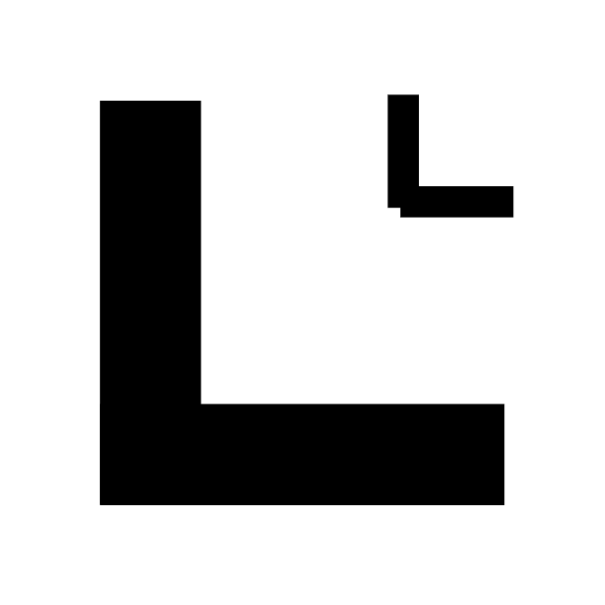

<div align="center">

<picture>
	<source media="(prefers-color-scheme: dark)" srcset="./assets/logos-and-animations/little-dark-icon-b.png" />
	
</picture>

# Little Later

**Save it now, get back to it later.** A local-first Chrome extension for saved pages, tasks, reminders and notes, with an optional AI assistant that can run on your own machine.

[](https://github.com/AndysTMC/Little-Later/actions/workflows/ci.yml)
[](https://github.com/AndysTMC/Little-Later/actions/workflows/codeql.yml)
[](https://scorecard.dev/viewer/?uri=github.com/AndysTMC/Little-Later)
[](https://github.com/AndysTMC/Little-Later/releases/latest)
[](./LICENSE.md)

</div>

<p align="center">
	
	
	
	
</p>

Little Later has no account, no server and no sync. Everything you save is stored in your browser profile and encrypted on disk. The only data that ever leaves your machine is what you choose to send to an AI provider you set up yourself.

## Features

- **Saves and history.** Little Later keeps a history of the pages you visit, each with a screenshot preview. Save a page from the right-click menu, or later from your history.
- **Tasks.** Tasks with no deadline, a due date, or a daily, weekly, monthly or yearly repeat. Overdue tasks move to a Missed group, and a task can carry its own reminder.
- **Reminders.** Browser notifications at a set time, or escalating reminders that fire more often as the time gets close. Recurring times follow you when you change time zone.
- **Notes.** Markdown notes with edit and preview. Select text on a page and choose **Note text** to save it as a note.
- **Links between records.** Attach a save to a note, task or reminder, and a reminder to a task.
- **Search** across saves, tasks, reminders and notes.
- **Profiles.** Several profiles in one browser, each with its own data, theme (light or dark) and optional password.
- **Backups.** Export a profile as an encrypted `.lldat` backup you can import later, or as readable JSON.
- **AI assistant (optional).** Chat with your own data: find saves, summarise history, create or update tasks, reminders and notes. Every change it proposes waits for your confirmation in the chat.

## Install

Little Later needs **Chrome 144 or later**, or another Chromium-based browser on the same version. It is not on the Chrome Web Store yet.

### From a GitHub release

1. Download `Little-Later-<version>.zip` from the [latest release](https://github.com/AndysTMC/Little-Later/releases/latest).
2. Extract it to a folder you will keep.
3. Open `chrome://extensions`, turn on **Developer mode**, click **Load unpacked** and select the folder.

To update, replace the folder's contents with the new release and click the extension's reload button. Release builds carry a fixed extension ID, so your data stays.

The release also has a signed `.crx`. Chrome on Windows and macOS only installs extensions from outside the Web Store through enterprise policy, so most people should use the zip.

Every release is built by GitHub Actions from a version tag on `main`, and ships SHA-256 checksums, a CycloneDX SBOM and signed build provenance. To check that a download was built from this repository:

```sh
gh attestation verify Little-Later-<version>.zip --repo AndysTMC/Little-Later
```

[SECURITY.md](./SECURITY.md#verifying-a-release) explains offline verification. Official builds are published only from this repository's releases and, once listed, the maintainer's Chrome Web Store account.

### From source

You need [Bun](https://bun.sh) 1.3.11 or later.

```sh
git clone https://github.com/AndysTMC/Little-Later.git
cd Little-Later
bun install
bun run build
```

Then load the `dist/` folder with **Load unpacked** as above.

> [!IMPORTANT]
> Version 3.0 stores data in a new encrypted format. Updating from 2.x removes the old data, and 2.x backups cannot be imported. Export what you want to keep as readable JSON before you update.

## Privacy and security

**What is stored.** Saves, history, tasks, reminders, notes, page previews and settings live in the extension's IndexedDB database and `chrome.storage` in your browser profile. Nothing is uploaded, and there is no telemetry.

**What is captured.** While a profile is unlocked, Little Later records the web pages you visit (`http` and `https` only) with a screenshot preview, to build your history. You choose how many history entries to keep, and how many per site, in **Settings → Misc**. Nothing is captured while the profile is locked.

**How it is encrypted.**

- Each profile has its own random 256-bit key. Every record's content (titles, URLs, page text, notes, task and reminder text, previews, and the AI provider settings including any API key) is encrypted with AES-256-GCM under that key.
- With a password, the profile key is wrapped by a key derived from the password with PBKDF2-SHA-256 at 600,000 iterations. Locking removes the unwrapped key from memory.
- A profile without a password still encrypts its records, but its key is stored next to them, so the app labels it _not encrypted at rest_.
- Some metadata stays readable so reminders can fire while locked: timestamps, status flags, schedules, the profile's name and avatar, and keyed hashes of URLs. It shows when and how often you saved something and repeat visits to a site, but not what you saved.
- There is no password recovery. If you forget a profile's password, its data cannot be read.

**Locking.** A password-protected profile locks when the browser starts, when the extension updates, when your screen locks, and after an idle time you choose (30 minutes by default). Reminders still fire while locked and ask you to unlock to see them.

**Backups.** A `.lldat` backup is encrypted with a password you choose when you export it. Importing creates a new profile with fresh keys and does not bring back the AI provider settings. The readable JSON export is plain text and leaves out API keys.

The full design, including exactly which fields stay readable, is in [decision 0010](./docs/decisions/0010-format-v1-storage-and-keys.md). To report a vulnerability, follow [SECURITY.md](./SECURITY.md).

### Permissions

| Permission                        | Why                                                                                    |
| --------------------------------- | -------------------------------------------------------------------------------------- |
| `tabs`, `activeTab`, `<all_urls>` | Record visited pages and take their screenshot previews                                |
| `storage`, `unlimitedStorage`     | Keep your data and settings in the browser, without the default storage cap            |
| `alarms`, `notifications`         | Fire reminders on time, even after Chrome suspends the background worker               |
| `idle`                            | Lock the profile when the screen locks or after the idle time you set                  |
| `contextMenus`                    | **Save page**, **Note text** and the AI note actions in the right-click menu           |
| `declarativeNetRequest`           | Let the extension's own requests reach Ollama or LM Studio on this machine (see below) |

## AI assistant

The assistant is off until you configure it in **Settings → AI**. It works with:

| Provider                             | Endpoint                                                |
| ------------------------------------ | ------------------------------------------------------- |
| [Ollama](https://ollama.com)         | `http://127.0.0.1:11434/v1` on this machine             |
| [LM Studio](https://lmstudio.ai)     | `http://127.0.0.1:1234/v1` on this machine              |
| Any OpenAI-compatible API (_Custom_) | A URL and API key you enter; `https` unless it is local |

Start the local server, load a model, then pick the provider and model in settings. Local servers reject requests from extension pages by default, so Little Later sends its own requests to them with a `127.0.0.1` origin; websites you visit do not get that header.

When you use the assistant, your messages and the records it reads to answer them are sent to the provider you chose. With Ollama or LM Studio that stays on your machine; with a custom provider it goes to that service under its terms. The assistant can read freely, but creating, changing, deleting or exporting anything needs your confirmation in the chat ([decision 0003](./docs/decisions/0003-ai-writes-need-confirmation.md)). The right-click actions **Note quick summary (AI)** and **Note keypoints (AI)** send only the selected text.

## Development

```sh
bun install
bun run build:shared   # build the shared package once
bun run dev            # then load dist/ in chrome://extensions
```


Official builds come only from this repository's releases and, once listed, the maintainer's Chrome Web Store listing. How releases are cut is in [CONTRIBUTING.md](./CONTRIBUTING.md#releases).


The service worker is the only code that writes data; the popup and the AI send it typed commands ([decision 0012](./docs/decisions/0012-single-writer.md)). Why the project is built the way it is lives in [docs/decisions](./docs/decisions/_index.md), what is being worked on now in [docs/now.md](./docs/now.md), and a map of the code in [AGENTS.md](./AGENTS.md#where-to-read).

## Contributing

Bug reports, ideas and pull requests are welcome. Please read [CONTRIBUTING.md](./CONTRIBUTING.md) first, and open an issue before starting on a large change. Everyone taking part follows the [Code of Conduct](./CODE_OF_CONDUCT.md).

See also: [getting help](./SUPPORT.md), the [security policy](./SECURITY.md) (report vulnerabilities privately, never in a public issue), [how the project is run](./GOVERNANCE.md) and the [changelog](./CHANGELOG.md).


MIT, see [LICENSE.md](./LICENSE.md). The license covers the code, not the name or logo: a version you publish yourself needs its own name and icons ([TRADEMARKS.md](./TRADEMARKS.md)). Every build includes `THIRD_PARTY_NOTICES.txt` with the license of each bundled package; the Rubik font is under the SIL Open Font License ([public/fonts/OFL.txt](./public/fonts/OFL.txt)).


The code is released under the [MIT License](./LICENSE.md). The license covers the code, not the Little Later name or logo: if you publish your own build, give it your own name and icons ([TRADEMARKS.md](./TRADEMARKS.md)).

Little Later is built with [React](https://react.dev), [Vite](https://vite.dev), [Dexie.js](https://dexie.org), [Tailwind CSS](https://tailwindcss.com), [Framer Motion](https://motion.dev) and the [OpenAI SDK](https://github.com/openai/openai-node). Every build includes `THIRD_PARTY_NOTICES.txt` with the license of each bundled package. The Rubik font is under the [SIL Open Font License](./public/fonts/OFL.txt).
